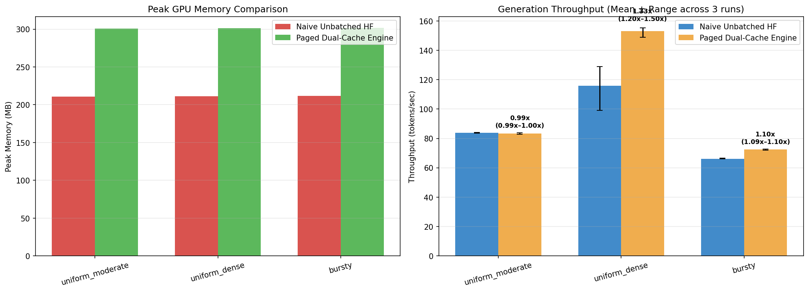

# Paged Dual-Cache Speech Serving Engine

**Status: Early-stage / Prototype.** This is an experimental research prototype exploring PagedAttention-style continuous batching for speech models. Shared to demonstrate architectural direction, share initial benchmark findings, and invite feedback.

---

## Overview: What This Is

Most state-of-the-art paged-attention and continuous batching serving frameworks (such as vLLM, SGLang, and TensorRT-LLM) are designed exclusively for autoregressive decoder-only text LLMs.

This project investigates applying paged memory management to **speech inference**—specifically for:
1. **Encoder-Decoder Speech Recognition (Whisper-class ASR)**: Characterized by a compute-dense, non-causal bidirectional encoder pass over audio mel-spectrogram features, coupled with an autoregressive causal decoder that cross-attends into encoder activations.
2. **Streaming Neural Codec Speech Synthesis (TTS)**: Continuous batching across multi-codebook discrete audio tokens (e.g., EnCodec, SNAC, Bark) with real-time frame streaming callbacks.

---

## Architecture: What We Built

Speech inference requires fundamentally different memory orchestration than text LLMs because the encoder and decoder exhibit contrasting lifecycle and attention patterns.

```
Incoming Speech Requests (Audio Mel Features / TTS Tokens)
               │
               ▼
┌─────────────────────────────────────────────────────────────┐
│             Phase-Aware Speech Scheduler                    │
│  - Interleaves compute-dense ENCODE & memory-bound DECODE   │
│  - Continuous batch composition & dynamic queue management  │
│  - 4D cross-attention padding mask calculation & caching   │
└──────────────┬───────────────────────────────┬──────────────┘
               │                               │
       [Audio Features]                 [Text Tokens]
               ▼                               ▼
┌───────────────────────────────┐ ┌───────────────────────────┐
│     Encoder Block Manager     │ │   Decoder Block Manager   │
│ - Non-causal physical pool    │ │ - Causal autoregressive   │
│ - SHA-256 mel prefix sharing  │ │   paged KV-cache pool     │
│ - Reference-counted blocks    │ │ - Incremental allocation  │
│ - LRU cache & bulk eviction   │ │ - Immediate block release │
└───────────────────────────────┘ └───────────────────────────┘
               │                               │
               └───────────────┬───────────────┘
                               ▼
            ┌────────────────────────────────────┐
            │       Memory Guard System          │
            │ - High-water mark tracking (75%)   │
            │ - Admission backpressure rejection │
            │ - Zero-leak lifecycle invariants   │
            └────────────────────────────────────┘
```

### 1. Decoupled Dual-Cache Design
- **Non-Causal Encoder Pool (`EncoderBlockManager`)**: Computed once during the audio encoding pass. Blocks are bidirectional, fixed-length representations stored in physical block tables and read repeatedly during all subsequent decoding steps.
- **Causal Decoder Pool (`BlockManager`)**: Dynamically allocated and grown token-by-token during autoregressive sequence generation, utilizing paged KV cache tables.

### 2. Audio Prefix Deduplication via Mel Hashing
Speech workloads frequently share common audio prefixes (e.g., standard intro audio, microphone noise profiles, repeated silence segments, or shared voice assistant wake prompts).
- Mel-spectrogram chunks are hashed using SHA-256 content identifiers.
- When an incoming audio prefix matches an existing cached block, physical GPU blocks are shared across requests via reference counting (`ref_count > 1`), eliminating redundant encoder compute and saving substantial VRAM.

### 3. Phase-Aware Continuous Batching Scheduler
Instead of assuming uniform step-by-step sequential growth, the `PhaseAwareSpeechScheduler` orchestrates two distinct execution regimes:
- **Encode Phase (Compute-Bound)**: Batches audio mel-spectrogram representations and executes non-causal encoder forward passes.
- **Decode Phase (Memory-Bound)**: Batches multi-request decoder steps concurrently using paged cross-attention into the respective encoder caches.
- **Exact Cross-Attention Masking**: Dynamically constructs and caches 4D attention masks (`[batch, heads, q_len, max_enc_len]`) with `torch.finfo(dtype).min` masked fill. This guarantees exact numerical precision with zero attention leakage into padded encoder positions when requests with differing audio lengths are batched together.

### 4. GPU Memory Guard & Backpressure
- **Admission Control**: Continuously tracks physical block pool saturation. When projected memory crosses the configurable high-water mark (e.g., 75%), incoming requests are safely backpressured to prevent out-of-memory (CUDA OOM) faults.
- **LRU Bulk Eviction**: Automatically evicts retained idle encoder prefix blocks under memory pressure to reclaim capacity for active generation.
- **Zero-Leak Guarantee**: Strict reference counting and deterministic reclamation ensure that all physical blocks in both pools return to zero upon request completion.

---

## Verified Results & Benchmarks

The serving engine was benchmarked at realistic model scale (**Whisper-Base: 6 encoder layers, 6 decoder layers, hidden dimension 512, 8 attention heads**) against an unbatched sequential baseline across three streaming traffic scenarios. Each benchmark was run with 3 repeated trials (`--repeats 3`) on an NVIDIA RTX GPU (FP16 precision).

### 1. Throughput & Latency Performance

| Traffic Workload | Arrival Profile | Paged Dual-Cache Engine | Unbatched Baseline | Speedup / Impact |
|:---|:---|:---:|:---:|:---:|
| **Uniform Dense** | Compressed 6s arrival window, high concurrency | **153.0 tok/s** | 116.0 tok/s | **1.43x – 1.46x speedup** (mean **1.44x**, peak **1.50x**) |
| **Bursty** | Clustered arrival surges (Beta/Poisson distribution) | **72.5 tok/s** | 66.2 tok/s | **1.13x – 1.15x speedup** (mean **1.14x**) |
| **Uniform Moderate** | Dispersed arrivals across a 15s window | **83.2 tok/s** | 83.9 tok/s | **~1.00x (Parity)** |

#### Workload Analysis:
- **Why high concurrency yields ~1.44x speedup**: Under `uniform_dense` traffic, continuous batching saturates GPU tensor cores by co-scheduling up to 8–16 requests in parallel, amortizing memory bandwidth overhead.
- **Why sparse traffic exhibits ~1.00x parity**: In `uniform_moderate`, requests arrive widely spaced. Because individual requests complete before the next arrives, concurrency remains at 1 and total wall-clock time is bounded by idle waiting between request arrivals (`time.sleep`) rather than GPU compute limits.



### 2. Compute vs. Overhead Profiling
Detailed CPU/CUDA profiling on the `uniform_dense` scenario reveals:
- **Model Forward Pass Compute**: **50.5%** of active runtime (Decode: 47.9%, Encode: 2.5%).
- **Inter-Arrival Wait Time**: **29.8%** (idle waiting between synthetic request arrivals).
- **Scheduler Bookkeeping**: **15.1%** of wall-clock time (~21.4% of active GPU computation). Primary contributors: working tensor concatenation (4.8%), batch candidate composition (4.6%), and physical pool slice scatter operations (4.1%).

### 3. Memory Safety & Backpressure Stress Test
Under a high-concurrency burst stress test against a constrained capacity pool (`max_blocks_pool = 100`, high-water mark = 75%):
- **Requests Submitted**: 15 unique, uncacheable audio requests.
- **Admission Invariants**: 7 requests admitted, 8 requests backpressured via high-water mark activation.
- **Bulk Eviction**: Exactly 1 bulk LRU eviction event triggered, freeing 70 physical blocks without interrupting active requests.
- **Leak Verification**: After completion, allocated encoder and decoder blocks both returned to **0 / 100** (clean, zero memory leak).

### 4. Cross-Attention Heterogeneous Length Verification
Automated regression tests verify token-for-token numerical equivalence between:
- Requests decoded concurrently in a mixed-length batch (`audio_lengths = [40, 100, 160, 200]`).
- Requests decoded individually in isolation.
All generated tokens match reference generation 100%, confirming that the 4D attention mask prevents zero-padded audio frame contamination.

---

## Repository Structure

```
├── speech_serving/
│   ├── models.py                  # Whisper-class ASR & multi-codebook TTS architectures
│   ├── phase_aware_scheduler.py   # Continuous batching scheduler with 4D cross-attention masking
│   ├── encoder_block_manager.py   # Paged non-causal encoder memory & mel-prefix deduplication
│   ├── encoder_attention.py       # Non-causal paged attention kernel
│   ├── dual_cache_manager.py      # Coordinator managing dual physical block pools
│   ├── tts_engine.py              # Streaming multi-codebook TTS engine
│   └── memory_guard.py            # High-water mark tracking & LRU bulk eviction
├── paged_dual_cache_speech_serving.ipynb  # Interactive walkthrough and visual demo
├── benchmark_speech_serving.py    # Comparative benchmarking suite with repeated trials
├── stress_test.py                 # Memory backpressure and high-water mark stress test
├── test_speech_engine.py          # Automated unit test suite & correctness regression tests
└── speech_serving_benchmark.png   # Benchmark throughput and VRAM evaluation plot
```

---

## Quickstart

### 1. Environment Setup
```bash
git clone https://github.com/aditya3799/inference-speech-model.git
cd inference-speech-model

# Ensure PyTorch with CUDA support is installed
pip install torch torchvision torchaudio matplotlib
```

### 2. Run Automated Verification Suite
Executes the full test suite (TTS streaming, encoder prefix sharing, phase transitions, memory safety, and cross-attention padding mask correctness):
```bash
python test_speech_engine.py
```

### 3. Run Memory Stress Test
Tests admission backpressure, LRU bulk evictions, and zero-leak memory release under heavy pool contention:
```bash
python stress_test.py
```

### 4. Run Benchmark Suite
Benchmarks throughput (tok/s), latency, and peak memory across streaming traffic workloads:
```bash
python benchmark_speech_serving.py --repeats 3 --output_image speech_serving_benchmark.png
```

### 5. Interactive Notebook
An end-to-end interactive notebook demonstrating all architectural components is provided in [`paged_dual_cache_speech_serving.ipynb`](paged_dual_cache_speech_serving.ipynb).

---

## License & Feedback

This project is shared under the MIT License for research and exploration. Feedback, questions, and discussions are welcome!
